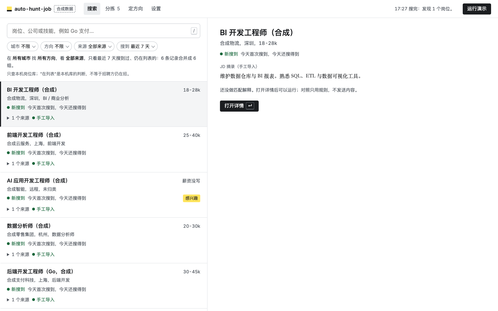
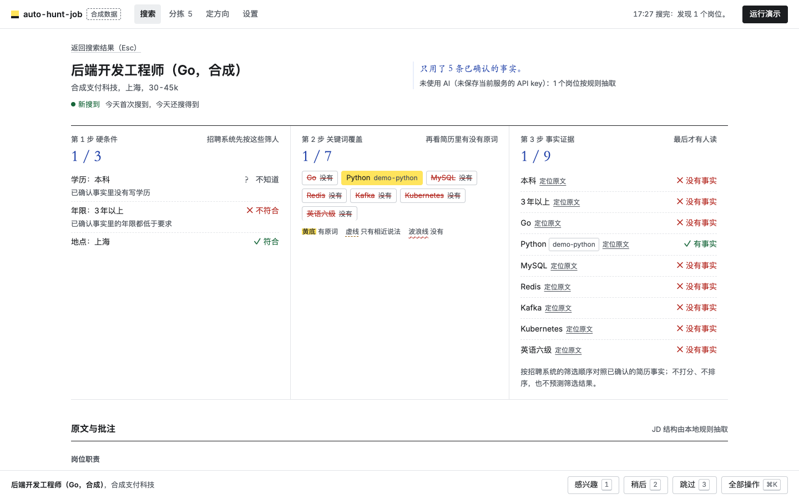

# auto-hunt-job

English | [简体中文](README.zh-CN.md)

Less time re-running the same job searches, more time on the openings that fit.

auto-hunt-job is a job-search tool that runs on your own computer. It collects postings from company career sites and public recruiting APIs into a local job library and searches them in full text. Each posting is explained against the résumé facts you have confirmed, in the order an applicant tracking system (ATS) screens candidates. Nothing is applied for or sent anywhere without your review.

> **Developer preview.** Search is read-only and covers the sources listed below, not the whole web. It ships with a synthetic candidate, and the real-submission quota is 0. Résumé parsing and profiling run locally. Every feature works without a model service; AI is used only after you configure one and consent to what gets sent.

The interface is in Chinese. The job sources are mainly Chinese employers and international companies hiring in China.



## What it does

- **Job search engine.** Reads postings from company career sites and public recruiting APIs and stores them in a local SQLite library with full-text search (FTS5). Each posting records when it was first and last seen. Postings that stop appearing are closed. The same posting found on several sources is grouped into one result.
- **Direction finding.** Asks you a few questions, then proposes 1–4 job directions from a reference table of 163 directions in 20 families. Each direction lists strengths, gaps and risks backed by your confirmed facts or by evidence from job descriptions. It also gives the search terms it will use, directions not to prioritize, and things you can do today.
- **Match explanation in ATS order.** Each posting is checked in three steps: hard requirements (education, years, language, location, remote), keyword coverage (whether your résumé uses the posting's exact words, only a near wording, or neither), and fact-by-fact evidence. There is no score and no prediction of the outcome.
- **Triage.** One key per decision: interested `1`, later `2`, skip `3`, undo `U`. Choosing "interested" prepares local application materials in the background.
- **Review before anything leaves your machine.** Materials, recipients and file snapshots are reviewed together. An approval is tied to one snapshot and expires when anything in it changes.



## Quick start

Python 3.10+ on macOS or Linux. Local acceptance runs on macOS with Python 3.12; CI covers Linux.

```sh
git clone https://github.com/zahT3/auto-hunt-job.git
cd auto-hunt-job
sh setup.sh
.venv/bin/python -m hunt web
```

Open <http://127.0.0.1:8766/>. On macOS you can also double-click `Start.command`. To try it with synthetic data only, run `.venv/bin/python -m hunt web --demo`.

Generating Chinese PDFs on Linux needs a Chinese TrueType font, for example `fonts-wqy-zenhei`. You can also point `HUNT_PDF_FONT` at a Chinese TTF/TTC you are licensed to use. No PDF font is bundled.

## From résumé to postings

1. **Upload a résumé** (PDF, DOCX, TXT or MD, up to 10 MiB). Keep "synthetic candidate" checked when using the samples.
2. **Confirm facts.** Each extracted fact shows its source page or paragraph; tick only the accurate ones. Confirmed facts are used for local profiling and matching and stay private by default.
3. **Find directions** on the 定方向 page. Answer the questions or skip them, then adopt, edit or pick directions yourself. Without a model service or consent, the questions and suggestions come from local rules and are labelled 未使用 AI ("AI not used").
4. **Search.** Search terms come from your directions. The search runs in the background within request, page and job limits. It reports the actual status of every source, showing empty, blocked and failed separately.
5. **Read a posting.** The job page shows the three screening steps side by side, then the original text with margin notes that cite only confirmed facts.
6. **Triage and review.** Sort postings with `1` / `2` / `3`. Searching never sends a message or an application.

Scanned PDFs need OCR, which is not integrated yet; for mixed PDFs, the pages that could not be read are listed. The rules extract skills, education and explicitly stated total years. They do not infer seniority from project dates or treat a keyword hit as proficiency.

## AI (optional)

- **Service.** Any OpenAI-compatible API. The default reference is DeepSeek (`https://api.deepseek.com`, model `deepseek-v4-flash`). Cost estimates default to ¥1 per million input tokens and ¥2 per million output tokens; check the provider's current prices.
- **Key.** Save it on the settings page or with `python -m hunt ai key` (input is hidden). It is stored only in `private/app/secrets.json` (mode 0600) and sent only to the host it was saved for. Changing the host requires entering the key again.
- **Consent.** Nothing is sent before you consent. There are four content kinds: redacted résumé, full résumé, job text and search query. Consent is bound to the host, the model and the content kind; changing the host or the model voids it. Grant it on the settings page or with `python -m hunt ai consent`, and revoke it with `python -m hunt ai revoke`.
- **Budget.** ¥5 per run by default, configurable from 0 to 100. Each call's cost is estimated at its worst case first. A call that could exceed the budget is not made; the rest falls back to rules, and the result notes where the switch happened.

## Sources and coverage

| Source | How | Limits |
| --- | --- | --- |
| Tencent, Alibaba, Meituan, Xiaohongshu, DiDi, JD, NetEase | Each company's public careers JSON API | Public listings only. An API change is reported as `parse_error`, not as "no jobs" |
| ByteDance and Feishu recruiting tenants (`*.jobs.feishu.cn`) | Feishu recruiting public API | These hosts only. Rate limits and structure changes are reported separately |
| Moka tenants (`app.mokahr.com`, `hire-r1`) | Moka public API | `app.mokahr.com` responses are encrypted and need `requirements-sources.txt`; without it these tenants report `not_configured` |
| Beisen (`*.zhiye.com`), Dayee (`hotjob.cn`, `wintalent.cn`) | Public portal APIs | Tenants in the seed file |
| Greenhouse, Lever, Ashby | Public job-board APIs | Configured boards only |
| Other company career sites | Same-site crawl within budget, JobPosting data, linked ATS boards | Sites without structured data or with private APIs report limited parsing |
| BOSS Zhipin, Liepin and other pages that need sign-in | Bookmarklets: click one while you browse, and the current page goes to the local inbox. Install them from 岗位书签 on the settings page, or open `/bookmarklets` | Only what you see when you click. Off by default as automated sources |
| Web search | Optional self-hosted SearXNG JSON endpoint | Results are re-fetched from the source before use |

A **sweep** (`sweep: true` in the config) scans a seed list of 124 employers (97 by default; the rest are marked as needing an adapter or dead), related sources first. Default limits are 300 companies, 1500 jobs, 3000 requests and 600 seconds; see [docs/usage.md](docs/usage.md#大范围搜索).

**Measured recall** (2026-11-02; direction "AI product manager"; rules-only classification; default sweep limits; two rounds into one library): the tool found **417 of 560** hand-checked postings from official sources (74.5%). Counting only postings classified into that direction, it found 376 of 560 (67.1%). The answer key was compiled six days earlier, so postings that closed since then count as misses. Kuaishou, Ctrip, miHoYo and Xiaomi have no reader yet (86 postings, 0 found). The method and every run so far are in [docs/benchmark.md](docs/benchmark.md).

### Optional browsers

```sh
.venv/bin/python -m pip install -r requirements-executor.txt   # Playwright, for rendering public pages
.venv/bin/python -m playwright install chromium
.venv/bin/python -m pip install -r requirements-platform.txt   # adds Patchright for the platform browser mode
```

With Patchright installed, the BOSS and Liepin browser mode uses it, because Liepin blanks the page when it detects Chrome's debugging Runtime. Using it may break the platforms' terms and get your account restricted; see [SECURITY.md](SECURITY.md). Without Patchright, the mode falls back to Playwright. You sign in yourself in a separate window. Your everyday Chrome cookies are never reused, and CAPTCHAs are never solved automatically.

## Command line and agents

The web page and the CLI share one local data directory. `python -m hunt --help` lists every command, including `search`, `scan`, `resume`, `confirm`, `directions`, `job_match`, `jd_extract` and `nl_query`. Commands print JSON, so an agent on your own computer (Claude Code, Codex and others) can drive the whole flow. The JSON shapes are in [docs/agent-mode.md](docs/agent-mode.md).

```sh
.venv/bin/python -m hunt search AI 产品经理 --city 深圳 --city 杭州 --json
```

## Data and privacy

Data lives in `private/app/` by default. Originals, facts, jobs, materials, approvals and execution records all stay on your computer. Quit the runner before backing up the whole directory. Use `--data <dir>` for a separate directory and `--demo` for an isolated synthetic one.

Uploading a résumé does not change the active candidate until you confirm facts, and confirming a fact does not allow disclosing it. Application materials use only facts that are both confirmed and allowed for applications. Only the Anker channel has a controlled executor, and its live submission and receipt have not yet passed acceptance; every other channel is read-only. An application with an unknown result is never resent automatically. See [SECURITY.md](SECURITY.md).

## Project layout

```
hunt/net/        network access and SSRF protection
hunt/search/     search engine: query, engine, job library index, sources
hunt/ai/         model client and consent, directions, JD structure, match explanation
hunt/profile/    résumé import, profile, redaction, direction table
hunt/workbench/  materials, review, execution (frozen)
hunt/app/        store, local server, CLI
static/          native HTML/CSS/JS as ES modules; no framework, no external resources
```

Imports may only point downward (`app → workbench / ai / search / profile → net`), and `tests/test_dependencies.py` enforces this. Conventions for contributors and agents are in [AGENTS.md](AGENTS.md); the design spec is [docs/DESIGN.md](docs/DESIGN.md).

## Development

```sh
.venv/bin/python -m unittest discover -s tests -v
node --test tests/test_frontend.cjs
for f in $(git ls-files 'static/js/*.js'); do node --input-type=module --check < "$f"; done
.venv/bin/python scripts/build_release.py --check    # no personal paths or key-like content in tracked files
.venv/bin/python examples/generate_synthetic_resume.py
```

Browser tests need the optional dependencies and Chromium. When those are missing, the tests are skipped and the run says so. Use only synthetic data in tests, screenshots and bug reports.

## License

[MIT](LICENSE). Contributions to job sources, résumé parsing, match explanation and accessibility are welcome; see [CONTRIBUTING.md](CONTRIBUTING.md) and [THIRD_PARTY_NOTICES.md](THIRD_PARTY_NOTICES.md).
