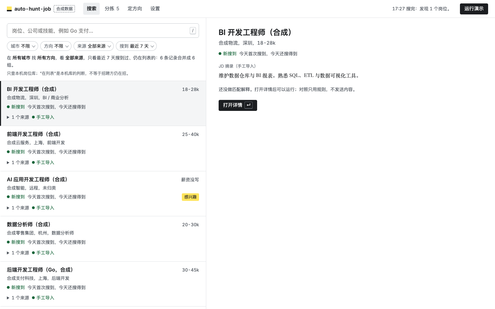
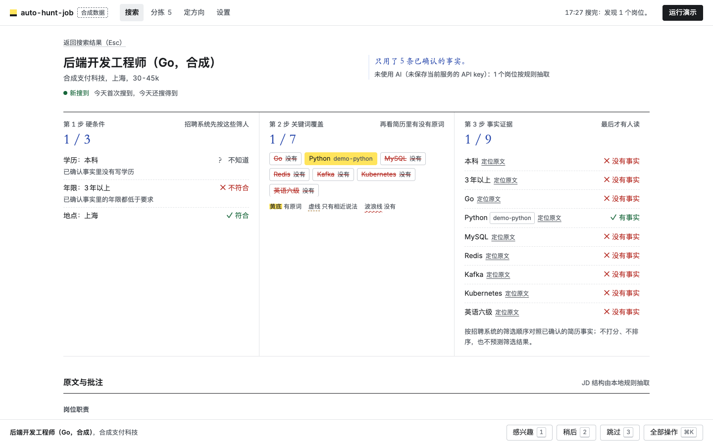

# auto-hunt-job

[English](README.md) | 简体中文

少一些重复搜索，多一些合适的机会。

auto-hunt-job 是在你自己电脑上运行的找工作工具。它从公司招聘官网和公开招聘接口收集岗位，存进本机岗位库，可以全文检索。每个岗位都会对照你已确认的简历事实，按招聘方 ATS（招聘管理系统）的筛选顺序给出解释。没有你审核，什么都不会申请，也不会发出去。

> **开发预览版。** 搜索只读，覆盖下面列出的来源，不是全网。默认用合成候选人，真实提交额度为 0。简历解析和画像都在本地完成。不配模型服务也能用全部功能；只有配置了模型服务、并且你同意发送相应内容之后，才会用 AI。

界面是中文的。岗位来源以中国雇主和在华招聘的外企为主。



## 能做什么

- **岗位搜索引擎。** 从公司官网和公开招聘接口读取岗位，存进本机 SQLite 岗位库，支持全文检索（FTS5）。每个岗位记录首次搜到和最近搜到的时间；连续没再出现的岗位会标为下线。同一个岗位出现在多个来源时，合成一条结果。
- **定方向。** 先问你几个问题，再从方向参考表（20 个大类、163 个方向）里提出 1–4 个求职方向。每个方向列出优势、短板和风险，每条都引用你已确认的事实或 JD 里的依据；同时给出会用到的搜索词、暂不建议优先投的方向，以及今天就能做的事。
- **按 ATS 顺序解释匹配。** 每个岗位分三步看：硬条件（学历、年限、语言、地点、远程）；关键词覆盖（简历里用的是岗位原词、只有相近说法，还是没有）；逐条事实证据。不打分，也不预测筛选结果。
- **分拣。** 一个决定一个键：感兴趣 `1`、稍后 `2`、跳过 `3`、撤销 `U`。选了"感兴趣"，后台会在本地准备申请材料。
- **发出去之前先审核。** 材料、接收方和文件快照放在一起审核。批准绑定具体快照，其中任何内容变了，批准就失效。



## 快速开始

需要 Python 3.10+，macOS 或 Linux。本机验收环境是 macOS + Python 3.12，Linux 由 CI 检查。

```sh
git clone https://github.com/zahT3/auto-hunt-job.git
cd auto-hunt-job
sh setup.sh
.venv/bin/python -m hunt web
```

打开 <http://127.0.0.1:8766/>。macOS 也可以双击 `Start.command`。只想用合成数据试用，运行 `.venv/bin/python -m hunt web --demo`。

在 Linux 上生成中文 PDF 需要中文 TrueType 字体，例如安装 `fonts-wqy-zenhei`；也可以把环境变量 `HUNT_PDF_FONT` 指向一个你有使用权的中文 TTF/TTC。项目不带 PDF 字体。

## 从简历到岗位

1. **上传简历**：PDF、DOCX、TXT 或 MD，最大 10 MiB。用合成样例时，保持「合成候选人」勾选。
2. **核对事实**：每条提取出的事实都标明来自哪一页或哪一段，只勾选准确的。确认后的事实只用于本地画像和匹配，默认不对外披露。
3. **定方向**：在「定方向」页回答问题，或者跳过；然后采纳、修改建议方向，也可以自己选。没配模型服务或没同意发送时，问题和建议都由本地规则生成，页面会标明「未使用 AI」。
4. **搜索**：搜索词来自你定的方向。搜索在后台运行，受请求数、页数和岗位数上限约束。每个来源的实际状态都会显示出来，没有结果、被拦截、出错三种情况分开标。
5. **看岗位**：岗位页上方三栏并排显示三步筛选，下方是原文配页边批注，批注只引用已确认的事实。
6. **分拣和审核**：用 `1` / `2` / `3` 分拣。搜索过程不会发消息，也不会申请。

扫描版 PDF 需要 OCR，目前还没集成；混合 PDF 会列出读不出来的页。规则只提取技能、学历和明确写出的总工作年限，不会从项目时间推算资历，也不把关键词命中当成熟练程度。

## AI（可选）

- **服务**：任何 OpenAI 兼容接口。默认参考 DeepSeek（`https://api.deepseek.com`，模型 `deepseek-v4-flash`）。费用默认按每百万 token 输入 1 元、输出 2 元估算，以服务商当前价格为准。
- **密钥**：在设置页保存，或者用 `python -m hunt ai key`（输入时不显示）。密钥只存在 `private/app/secrets.json`（权限 0600），只发给保存时的那个服务主机。换了服务地址要重新输入。
- **同意**：同意之前什么都不发。内容分四类：脱敏简历、完整简历、岗位原文、搜索需求。同意记录绑定服务主机、模型和内容类别，换了主机或模型就自动失效。在设置页给出同意，或者用 `python -m hunt ai consent`；用 `python -m hunt ai revoke` 撤销。
- **花费**：每轮默认上限 5 元，可设 0–100 元。每次调用前先按最坏情况估算；可能超出上限的调用不发，剩下的部分改用规则，结果里会写明从哪里开始改用规则。

## 来源与覆盖

| 来源 | 接入方式 | 边界 |
| --- | --- | --- |
| 腾讯、阿里巴巴、美团、小红书、滴滴、京东、网易 | 各公司招聘站的公开 JSON 接口 | 只读公开岗位列表。接口改版会报 `parse_error`，不会当成没有岗位 |
| 字节跳动、飞书招聘租户（`*.jobs.feishu.cn`） | 飞书招聘公开接口 | 仅限这些主机。限流和结构变化单独报告 |
| Moka 租户（`app.mokahr.com`、`hire-r1`） | Moka 公开接口 | `app.mokahr.com` 的响应是加密的，需要装 `requirements-sources.txt`；没装时这类租户报 `not_configured` |
| 北森（`*.zhiye.com`）、大易（`hotjob.cn`、`wintalent.cn`） | 公开门户接口 | 限种子文件里的租户 |
| Greenhouse、Lever、Ashby | 公开招聘看板 API | 只扫已配置的看板 |
| 其他公司官网 | 预算内同站遍历、JobPosting 结构化数据、页面关联的 ATS 看板 | 没有结构化数据或用专用接口的网站，会报告解析受限 |
| BOSS 直聘、猎聘等需要登录的页面 | 书签：你浏览时点一下，当前页面发到本机收件箱。在设置页点「岗位书签」或打开 `/bookmarklets` 安装 | 只发送你点击时看到的内容。作为自动来源默认关闭 |
| 网页搜索 | 可选的自建 SearXNG JSON 接口 | 结果要回到原站取正文后才使用 |

**大范围搜索**（配置里设 `sweep: true`）会扫描 124 家种子雇主，其中 97 家默认扫，其余标记为需要专用适配或已失效；相关来源先扫。默认上限是 300 家公司、1500 个岗位、3000 次请求、600 秒，详见 [docs/usage.md](docs/usage.md#大范围搜索)。

**实测召回**（2026-11-02；方向「AI 产品经理」；只用规则归类；默认大范围搜索上限；两轮写进同一个岗位库）：官网来源的人工标准答案共 560 个岗位，找回 **417 个**（74.5%）；只算归到该方向的岗位，是 376 个（67.1%）。标准答案是 6 天前整理的，这期间下线的岗位也算没找回。快手、携程、米哈游、小米还没有读取器（标准答案里 86 个，找回 0）。方法和历次结果见 [docs/benchmark.md](docs/benchmark.md)。

### 可选浏览器

```sh
.venv/bin/python -m pip install -r requirements-executor.txt   # Playwright，用于渲染公开页面
.venv/bin/python -m playwright install chromium
.venv/bin/python -m pip install -r requirements-platform.txt   # 再加上 Patchright，用于平台浏览器模式
```

装了 Patchright 时，BOSS、猎聘的浏览器模式用它驱动，因为猎聘一旦检测到 Chrome 调试接口的 Runtime 功能，就会把页面清空。用它可能违反平台条款，账号有被限制的风险，见 [SECURITY.md](SECURITY.md)。没装时退回 Playwright。登录由你本人在独立窗口完成；不会复用你日常 Chrome 的 Cookie，也不会自动过验证码。

## 命令行与 agent

网页和命令行共用同一个本地数据目录。`python -m hunt --help` 列出全部命令，包括 `search`、`scan`、`resume`、`confirm`、`directions`、`job_match`、`jd_extract`、`nl_query`。命令输出 JSON，你电脑上的 agent（Claude Code、Codex 等）可以用它们走完整个流程。JSON 结构见 [docs/agent-mode.md](docs/agent-mode.md)。

```sh
.venv/bin/python -m hunt search AI 产品经理 --city 深圳 --city 杭州 --json
```

## 数据与隐私

数据默认存在 `private/app/`。原件、事实、岗位、材料、批准和执行记录都留在你的电脑上。备份时先退出运行器，再备份整个目录。用 `--data <目录>` 指定独立的数据目录，用 `--demo` 使用隔离的合成数据。

上传简历后，只有确认了事实，当前候选人才会更新；确认事实也不等于允许对外披露。申请材料只用既已确认、又允许用于申请的事实。目前只有安克渠道有受控执行器，它的线上提交和回执还没通过验收；其他渠道都是只读。结果未知的申请不会自动重发。详见 [SECURITY.md](SECURITY.md)。

## 项目结构

```
hunt/net/        网络请求与 SSRF 防护
hunt/search/     搜索引擎：检索词、搜索编排、岗位库索引、来源
hunt/ai/         模型客户端与同意、定方向、JD 结构化、匹配解释
hunt/profile/    简历导入、画像、脱敏、方向参考表
hunt/workbench/  材料、审核、执行（冻结）
hunt/app/        Store、本地服务、命令行
static/          原生 HTML/CSS/JS（ES modules），不用框架，不加载外部资源
```

依赖只能自上而下（`app → workbench / ai / search / profile → net`），由 `tests/test_dependencies.py` 检查。贡献者和 agent 的约定见 [AGENTS.md](AGENTS.md)；设计规范见 [docs/DESIGN.md](docs/DESIGN.md)。

## 开发

```sh
.venv/bin/python -m unittest discover -s tests -v
node --test tests/test_frontend.cjs
for f in $(git ls-files 'static/js/*.js'); do node --input-type=module --check < "$f"; done
.venv/bin/python scripts/build_release.py --check    # 已跟踪文件里不能有本机路径或类似密钥的内容
.venv/bin/python examples/generate_synthetic_resume.py
```

浏览器测试需要可选依赖和 Chromium；缺少时会跳过，并在输出里注明。测试、截图和问题报告只用合成数据。

## 许可证

[MIT](LICENSE)。欢迎贡献招聘来源、简历解析、匹配解释和无障碍体验方面的改进，见 [CONTRIBUTING.md](CONTRIBUTING.md) 和 [THIRD_PARTY_NOTICES.md](THIRD_PARTY_NOTICES.md)。
